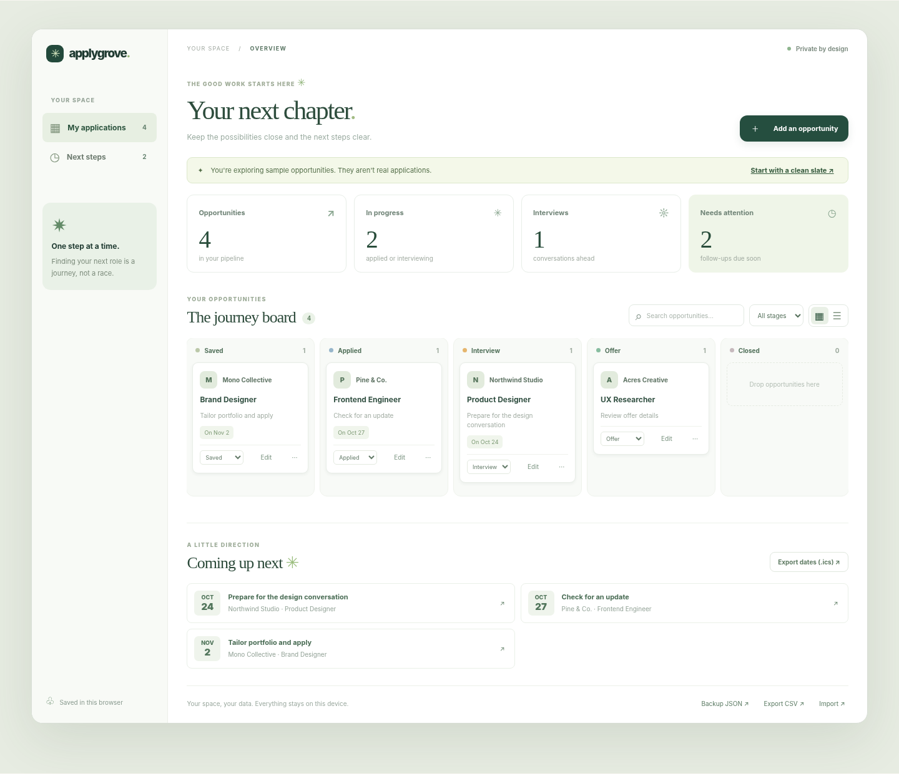
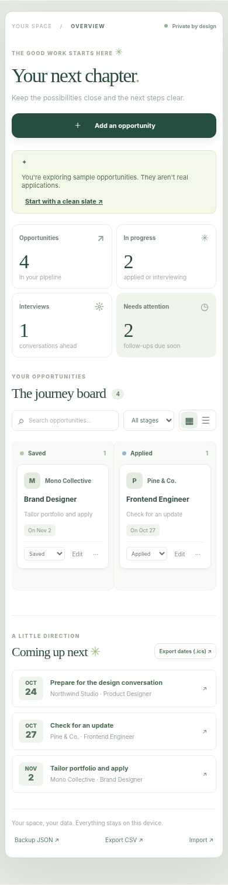

<div align="center">
  

  # Applygrove

  **Make room for what's next.**

  A calm, free, privacy-first application tracker for the job search.
  No account. No analytics. No subscriptions.

  [Get started](#run-locally) · [Features](#features) · [Deploy](docs/DEPLOYMENT.md) · [Contribute](CONTRIBUTING.md)
</div>


## A little less to carry

Keep saved roles, applications, interviews, offers, and follow-ups in one browser-based workspace. Applygrove helps you remember where you applied and what comes next, without asking you to hand your search data to another account.



## Features

- **A five-stage pipeline:** Saved, Applied, Interview, Offer, Closed. Drag cards or use accessible stage selectors.
- **Thoughtful follow-ups:** Assign your next action and its date; see upcoming tasks at a glance.
- **Calendar file:** Export follow-ups as `.ics` to import into your preferred calendar app. It does not schedule notifications automatically.
- **Follow-up writing helper:** Copy a plain, editable message draft for any opportunity. Nothing is sent on your behalf.
- **Portable data:** Export JSON backup or spreadsheet-compatible CSV; import JSON backups with schema validation and a clear replace confirmation.
- **Offline-capable:** After an initial HTTPS visit, its lightweight PWA shell can load without a network connection.
- **Privacy first:** No server database, telemetry, external scripts, account, or third-party fonts. Information is saved to your browser's local storage.
- **Accessible and responsive:** Mobile-friendly and keyboard-usable controls, reduced-motion support, visible focus states and semantic form fields.



> **Important:** Browser local storage is not encrypted and can be cleared by your browser, system cleanup tools, or other users with access to your browser profile. Back up your workspace regularly; JSON exports may include sensitive job-search information. There is no cloud sync, automatic email sending, or automatic job applying. This is a tracker, **not a job board**.

## Run locally

Node.js 22 or newer is recommended.

```bash
npm ci --ignore-scripts
npm run dev
```

Open `http://127.0.0.1:4173`. The dev server binds only to loopback.

```bash
npm run verify
```

This runs automated tests and builds static files into `dist/`.

## Deploy

Deploy `dist/` to any HTTPS static host. The project includes Cloudflare Pages `_headers`. See [deployment instructions](docs/DEPLOYMENT.md) for the build configuration and pre-launch checks.

## Architecture

Vanilla HTML, CSS, and ES modules; zero production dependencies. The browser performs all application management, storage, backup, CSV and calendar export operations. No third-party APIs are required.

```text
index.html        Accessible site and application shell
styles.css        Responsive editorial design and dashboard styling
src/core.js       Validation, pipeline metrics, exports and sample data
src/app.js        Interactive view, forms, local storage and events
assets/           Original image, logos, preview screenshots and icons
scripts/          Simple static build and localhost development server
tests/            Data validation, security, build and server tests
.github/          Continuous integration and contribution templates
```

## Contributing

Thoughtful accessibility fixes, bug reports and performance improvements are welcome. See [CONTRIBUTING.md](CONTRIBUTING.md) and [SECURITY.md](SECURITY.md). Do not post private hiring contacts, resumes, or real interview details in issues.

## License

[MIT License](LICENSE). Original photography and project visual assets were produced specifically for Applygrove. See [Asset notes](docs/ASSETS.md). The product name has not undergone a formal trademark clearance.
